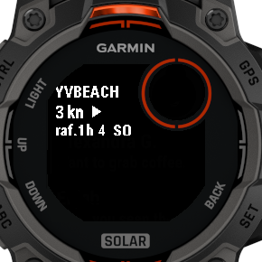
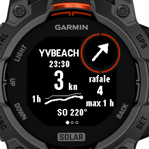
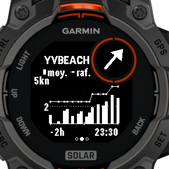
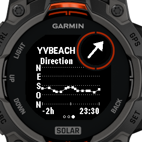

# BreezUp!

Live wind, lake forecasts and sport alerts for Lake Neuchâtel — on the phone and on a
Garmin Instinct 3.

* Live 10-minute average wind and gusts (plus the last 24 h) from the stations around the lake
* Forecasts for three exact spots on the lake (MeteoSwiss 1 km model via Open-Meteo)
* Your sports and sail sizes drawn as wind ranges on every chart, in knots or km/h
* Notifications when a forecast or a station enters one of your ranges
* A Garmin Instinct 3 Solar app: current wind, gust and trend per station, plus the last 2 hours

Personal project: the watch app is sideloaded, not on the Connect IQ Store.
See [docs/ARCHITECTURE.md](docs/ARCHITECTURE.md) for the design.

**Current scope (v0.1):** the Garmin watch app only, with the Yvbeach station. Charts, forecasts
and alerts are handled by Let's Kite's Wind Tracker app.

| Glance | Now | Wind, 2 h | Direction, 2 h |
|---|---|---|---|
|  |  |  |  |

Build: `garmin\build.ps1` (add `-Run` to open it in the Connect IQ simulator).

Forecast data: [Open-Meteo](https://open-meteo.com/) (CC BY 4.0), MeteoSwiss ICON-CH models.
Station data: winds.mobi, Cercle de la Voile d'Estavayer, and the station owners listed in the architecture document.
